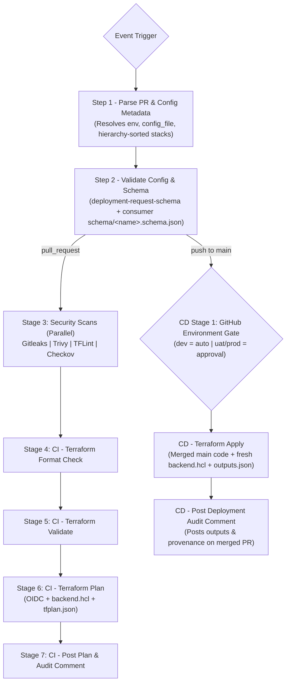

# Multi-Cloud Centralized Terraform CI/CD Architecture

This repository (`terraform-github-actions-templates`) provides an enterprise-grade, unified reusable GitHub Actions pipeline (`.github/workflows/terraform-pipeline.yml`) and nested pipeline modules for managing Infrastructure as Code across **GCP**, **AWS**, and **Azure**.

---

## 1. Core Design Principles

- **Unified Single Master Workflow**: One master workflow (`.github/workflows/terraform-pipeline.yml`) handles both PR previews (`pull_request`) and environment-gated provisioning (`push` to `main`).
- **Auditable Per-Tool Jobs**: Every tool (`Parse PR`, `Validate Schema`, `Gitleaks`, `Trivy`, `TFLint`, `Checkov`, `Terraform Format`, `Terraform Validate`, `Terraform Plan`, `PR Bot`, `Terraform Apply`, `CD Audit Bot`) executes in its own clearly named job without collapsing names under matrix wrappers.
- **Strict Dependency Hierarchy**: All target stacks are automatically sorted and applied sequentially in **`foundation ➔ network ➔ security ➔ compute ➔ availability`** order with fail-fast halting on error.
- **PR Concurrency Protection**: Stale/running PR pipelines cancel automatically when a new commit is pushed (`cancel-in-progress: ${{ github.event_name == 'pull_request' }}`), while `main` applies serialize per environment with `cancel-in-progress: false`.
- **Keyless OIDC Authentication (Node 24)**: Uses short-lived OIDC JWT tokens (`google-github-actions/auth@v3`, `aws-actions/configure-aws-credentials@v6`, `azure/login@v3`)—never long-lived cloud keys.
- **Dynamic `backend.hcl` Generation**: No hardcoded backend bucket names in Terraform root modules. Each job generates, prints, and passes `backend.hcl` via `-backend-config=backend.hcl`.
- **Consumer-Owned Environment Schemas**: Pipeline owns `schemas/deployment-request-schema.json`; each consumer repo stores per-configuration schemas in `schema/<name>.schema.json` (matched automatically from `configuration: <name>.yaml`).
- **Zero-Config Native Bot**: Uses `github.token` (`github-actions[bot]`) to update one sticky CI Plan & Compliance comment per PR and post a Deployment Audit comment on the merged PR.

---

## 2. Pipeline Execution Flow



---

## 3. Dynamic `backend.hcl` Generation

Before `terraform init -reconfigure -backend-config=backend.hcl`, the pipeline writes and logs `backend.hcl` dynamically:

### GCP (GCS)
```hcl
bucket = "<state_bucket_or_env-tfstate-bucket>"
prefix = "<env>/<stack>"
```

### AWS (S3 + DynamoDB)
```hcl
bucket         = "<state_bucket_or_org-terraform-state-env>"
key            = "<env>/<stack>/terraform.tfstate"
dynamodb_table = "tf-locks-<env>"
```

### Azure (Azure Storage Blob)
```hcl
resource_group_name  = "rg-tfstate-<env>"
storage_account_name = "<state_bucket_or_sttfstateenv>"
container_name       = "tfstate"
key                  = "<env>-<stack>.tfstate"
```

---

## 4. Artifact Passing (Non-Hidden Directories)

All cross-job artifacts use non-hidden directories (avoiding `actions/upload-artifact` hidden-dot exclusion):
* `security-reports/` (`gitleaks_report.txt`, `trivy_report.txt`, `checkov_report.txt`)
* `tf-plan-artifacts/<idx>/` (`meta.json`, `tfplan.json`, `plan.txt`, `backend.hcl`)
* `tf-apply-artifacts/<idx>/` (`meta.json`, `outputs.json`, `apply.log`, `backend.hcl`)
